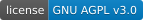

<!-- prettier-ignore -->
<div align="center">

# Nicholas M. Synovic — Curriculum Vitae

_LaTeX source for my curriculum vitae (CV), with modular sections, BibLaTeX-managed publication records, and automated PDF and DOCX builds through GitHub Actions._

[](LICENSE)

[Website](https://nicholassynovic.github.io/) · [LinkedIn](https://www.linkedin.com/in/nsynovic) · [GitHub](https://github.com/NicholasSynovic)

[Downloads](#downloads) • [Build Locally](#build-locally) • [Updating the CV](#updating-the-cv) • [License](#license)

</div>

## Downloads

Two GitHub Actions workflows build the CV on every push, tag, and pull request, and can also be triggered manually:

- [Compile CV](https://github.com/NicholasSynovic/cv/actions/workflows/build-pdf.yml) compiles `main.tex` and uploads the PDF as the `curriculum-vitae` artifact.
- [Compile CV DOCX](https://github.com/NicholasSynovic/cv/actions/workflows/build-docx.yml) converts the source to DOCX with Pandoc and uploads it as the `curriculum-vitae-docx` artifact.

To download a compiled copy:

1. Open the workflow and select a successful run.
2. Download the artifact.
3. Extract the archive to access `NicholasMSynovic_cv.pdf` or `NicholasMSynovic_cv.docx`.

Artifacts are retained for 30 days.

> [!NOTE]
> Pushing a Git tag publishes both files to a [GitHub Release](https://github.com/NicholasSynovic/cv/releases).

## Contents

The CV includes sections covering:

- Academic preparation
- Academic recognition
- Teaching experience
- Research and work
- Journal articles
- Conference papers
- Preprint manuscripts
- Presentations
- Media appearances
- Competitions
- Service

## Repository Structure

```text
.
├── .github/
│   └── workflows/
│       ├── build-pdf.yml    # Automated PDF compilation and artifact uploads
│       └── build-docx.yml   # Automated DOCX compilation and artifact uploads
├── bibliography/            # BibLaTeX data
│   ├── conferences.bib
│   ├── journals.bib
│   ├── preprints.bib
│   └── presentations.bib
├── docs/
│   └── license_badge.svg    # License badge referenced by this README
├── misc/
│   └── typesetting.tex      # Packages, formatting, and reusable commands
├── scripts/
│   └── build_docx.py        # Converts the LaTeX source to DOCX with Pandoc
├── sections/                # Individual CV sections
├── LICENSE
├── main.tex                 # Document entry point and contact information
└── README.md
```

Content and presentation are maintained separately: `main.tex` assembles the document, `sections/` holds the CV entries, and `misc/typesetting.tex` controls the layout.

## Build Locally

### Requirements

Install a LaTeX distribution with:

- pdfLaTeX
- `latexmk`
- Biber
- The packages used by the document: `geometry`, `fontenc`, `titlesec`,
  `enumitem`, `xurl`, `biblatex`, and `hyperref`

The bibliography uses BibLaTeX with the Biber backend.

The DOCX build additionally requires Python 3 and [Pandoc](https://github.com/jgm/pandoc) on the `PATH` (the DOCX workflow pins Pandoc 3.14); the build script uses only the Python standard library.

### Compile

Clone the repository and build from its root directory:

```sh
git clone https://github.com/NicholasSynovic/cv.git
cd cv

latexmk -pdf -file-line-error -halt-on-error -interaction=nonstopmode main.tex
```

The compiled document is written to `main.pdf`.

Alternatively, compile explicitly:

```sh
pdflatex -interaction=nonstopmode -halt-on-error main.tex
biber main
pdflatex -interaction=nonstopmode -halt-on-error main.tex
pdflatex -interaction=nonstopmode -halt-on-error main.tex
```

### Build the DOCX

From the repository root:

```sh
python3 scripts/build_docx.py
```

The script expands all `\input{...}` files, renders each bibliography `refsection` through Pandoc's citeproc, and writes `main.docx`.

### Clean Build Files

Remove intermediate compilation files while keeping the PDF:

```sh
latexmk -c main.tex
```

## Updating the CV

### Content

Edit the corresponding `.tex` file in `sections/`. To add or reorder sections, update the `\input{sections/...}` statements in `main.tex`.

Contact information and profile links are defined directly in `main.tex`.

### Publications

Each publication section renders every entry of its bibliography file:

```tex
\begin{refsection}[bibliography/journals.bib]
    \nocite{*}
    \printbibliography[heading=none]
\end{refsection}
```

To add a publication, append an entry to the relevant `.bib` file in `bibliography/` — `journals.bib`, `conferences.bib`, `preprints.bib`, or `presentations.bib`. A new bibliography file is referenced directly in the section's `refsection` argument.

Bibliography entries are sorted by year descending, then name and title. DOI links are enabled; when an entry has a DOI, its URL field is suppressed in the rendered bibliography.

### Formatting

Edit `misc/typesetting.tex` to change margins, headings, list spacing, bibliography formatting, or reusable commands.

The document uses an 11-point article layout on US letter paper with 0.75-inch margins.

The `\cventry` command formats an institution or employer, location, position or degree, and dates:

```tex
\cventry
    {Institution or Employer}
    {Location}
    {Position or Degree}
    {Dates}
```

## Continuous Integration

Two GitHub Actions workflows run on every push, tag, and pull request:

- [.github/workflows/build-pdf.yml](.github/workflows/build-pdf.yml) ("Compile CV") compiles `main.tex` using `xu-cheng/latex-action` and uploads the PDF as the `curriculum-vitae` artifact.
- [.github/workflows/build-docx.yml](.github/workflows/build-docx.yml) ("Compile CV DOCX") runs `scripts/build_docx.py` with Pandoc and uploads the DOCX as the `curriculum-vitae-docx` artifact.

If compilation fails, available logs are uploaded as artifacts and retained for 7 days: `main.log` and `main.blg` as `latex-build-logs`, and `main-docx.log` as `docx-build-logs`.

## License

This repository includes the GNU Affero General Public License, version 3. See [LICENSE](LICENSE) for the full terms.
